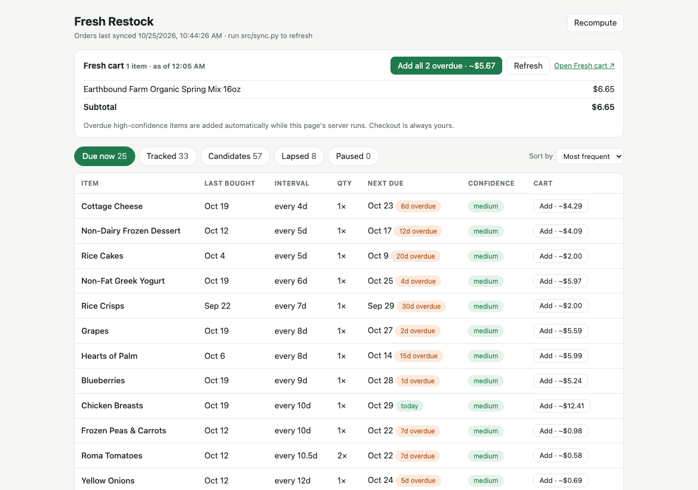

# Fresh Restock

I buy mostly the same groceries on Amazon Fresh every week, yet I kept rebuilding the cart by hand and forgetting things. Fresh Restock reads my Amazon Fresh order history, works out how often I buy each item, and shows what is overdue along with the reasoning behind every prediction. High-confidence overdue items are added to my Fresh cart automatically. I always check out myself.



## What it does

- Syncs your Amazon Fresh orders (Whole Foods and regular Amazon orders are skipped) into a local SQLite database.
- Groups products into item types and predicts, for each one, how often you buy it, how many you usually get, when it is next due and how confident the prediction is.
- Shows it all in a local dashboard: due, tracked, candidate, lapsed and paused items, sortable by frequency, last bought, name or next due.
- Explains each prediction (purchase gaps, typical wait, confidence) and lets you correct the interval or quantity, pause an item or move a product to another item type.
- Adds overdue items to your Fresh cart, either automatically (high confidence only) or with an Add / "Add all" button, and shows the cart with prices. It never checks out.

More detail on the design is in [design-grocery-shopping.md](design-grocery-shopping.md). [PROMPT-LOG.md](PROMPT-LOG.md) records how it was built.

## Run it

You need Python 3 and an Amazon account with Fresh orders.

```sh
python3 -m venv .venv
.venv/bin/pip install -r requirements.txt
.venv/bin/playwright install chromium   # Amazon's sign-in and the cart need a real browser

cp .env.example .env                     # then fill in AMAZON_USERNAME and AMAZON_PASSWORD (the OTP key is optional)

.venv/bin/python src/sync.py             # download your order history (first run: log in, may ask for a code)
.venv/bin/python src/app.py              # open http://127.0.0.1:5000
```

On macOS, port 5000 is often taken by AirPlay Receiver; use `--port 5055` (or any free port) if the page doesn't load.

Useful options:

- `src/app.py --no-auto` runs the dashboard without adding overdue items to the cart on its own.
- `src/sync.py --months 12 --full` changes the history window and refetches every order instead of just new and recent ones.
- `src/cart.py --dry-run` shows what would be added to the cart, `--refresh` only reads the cart, and with no flags it adds every high-confidence overdue item.

Run the tests with `.venv/bin/python -m unittest discover -s tests`.

## Privacy

Everything runs on your own computer. Your Amazon login lives only in `.env`, and your order history only in `data/`; both are gitignored. The app serves on `127.0.0.1` only and has no password, so don't expose it to a network. The screenshots in [screenshots/](screenshots/) show the author's own purchase history.
